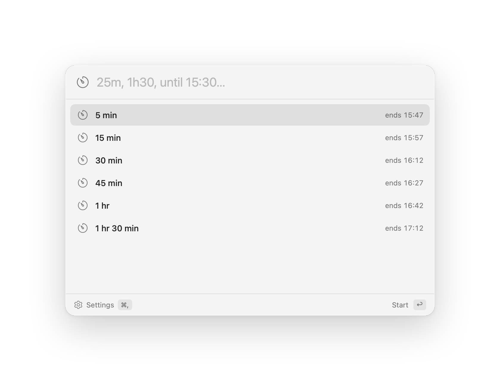
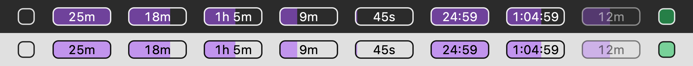
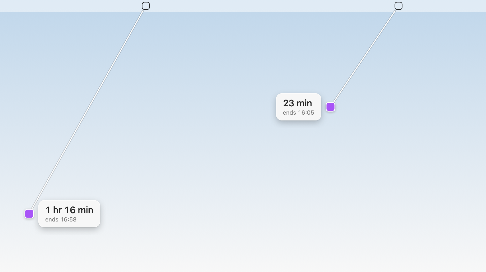

# Focus Timer

A countdown timer that lives in the macOS menu bar. Press ⌥Space, type `25m`
or `until 15:30`, press Return. The menu bar shows the time left, with a bar
behind it that drains as the timer runs.

<picture>
  <source media="(prefers-color-scheme: dark)" srcset="docs/images/panel-dark.png">
  
</picture>



Free and open source (MIT). No account and no tracking: the only time it goes
online is when you check for updates.

## Install

You need macOS 14 (Sonoma) or later, and Xcode.

1. Install [Xcode](https://apps.apple.com/app/xcode/id497799835) from the App
   Store and open it once, so it finishes setting up.
2. In Terminal, run:

   ```sh
   git clone https://github.com/fabio-bergmann/mac-focus-timer.git ~/mac-focus-timer
   cd ~/mac-focus-timer
   scripts/release-local.sh
   ```

That builds the app, installs it as `/Applications/Focus Timer.app` and starts
it. It shows up in the menu bar as a small rounded square.

Keep the `~/mac-focus-timer` folder: updates are built from it.

**Why build it yourself?** There's no Apple Developer licence behind this app,
so there is no notarized download to offer. An app built on your own Mac
carries no quarantine flag, so macOS opens it without a warning.

### If something's off

- **The build fails straight away.** macOS may be using the Command Line Tools
  instead of Xcode. Run
  `sudo xcode-select -s /Applications/Xcode.app` and try again.
- **No menu bar item.** A menu bar manager like Bartender or Ice may have put
  it under Hidden; move it to Shown. On a MacBook with a notch and a full menu
  bar, it can also be hidden behind the notch.
- **⌥Space opens something else.** The ChatGPT app and some launchers use it
  too. Pick another shortcut in Settings.
- **A notification prompt on your first timer.** Allow it to get a notice when
  a timer ends.

## Use

Press ⌥Space or click the menu bar item to open the panel. Pick a preset, or
type a time and press Return.

Or press the menu bar item and pull it down onto the screen. The further you
pull, the longer the timer, and letting go starts it. Hold Shift to step in
quarter hours. Letting go back at the menu bar cancels.

<picture>
  <source media="(prefers-color-scheme: dark)" srcset="docs/images/pull-dark.png">
  
</picture>

While a timer runs, the panel also offers Pause, Add 5 min and Stop. Starting
another timer replaces the current one. When it ends, a sound plays and a
green glow pulses around the screen. Control-click the menu bar item for its
menu.

### What you can type

| Input | Timer |
| --- | --- |
| `25` | 25 minutes (a bare number is minutes) |
| `34m`, `34 min`, `1h`, `90s` | that long |
| `1h30`, `1h 30m`, `1.5h`, `an hour and a half` | 1 hour 30 minutes |
| `2:30`, `1:30:00` | 2 min 30 sec, 1 hr 30 min |
| `until 15:30`, `at 3pm`, `@17:00` | until that time |
| `25m write report` | 25 minutes, labelled "write report" |
| `+10m` | adds 10 minutes to the running timer |

## Settings

⌘, in the panel. Presets (typed the same way as above), how the menu bar item
looks (bar colour and opacity, font weight, a fixed or fitted width, compact
`25m` or precise `24:59` time), the shortcut, what happens when a timer ends
(a sound, a glow around the screen), open at login, and updates.

## Update

**Settings → Check for updates** fetches the latest `main` from GitHub and,
when there's something new, rebuilds and reinstalls the app from your
`~/mac-focus-timer` folder. Your settings and a running timer carry over.

## Uninstall

Quit Focus Timer (Settings → Quit Focus Timer), then:

```sh
rm -rf "/Applications/Focus Timer.app" ~/mac-focus-timer
defaults delete dev.fabio.focustimer
```

## Development

```sh
scripts/dev.sh
```

Leave that running in a terminal tab. It builds the working tree as
"Focus Timer Dev" and relaunches it whenever a source file changes, beside the
installed app: separate settings, ⌃⌥Space as its shortcut, and an orange dot
on its menu bar item.

```sh
swift test
swift run FocusTimer --render-previews /tmp/focus-timer-previews
```

See [AGENTS.md](AGENTS.md) for how the code is laid out.

## License

[MIT](LICENSE). The icons are from the free [Hugeicons](https://hugeicons.com)
set, also MIT: see [THIRD-PARTY-NOTICES.md](THIRD-PARTY-NOTICES.md).
